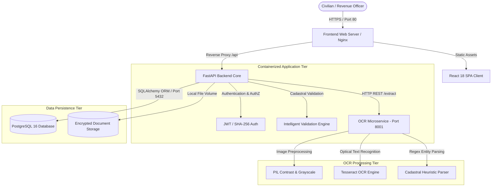
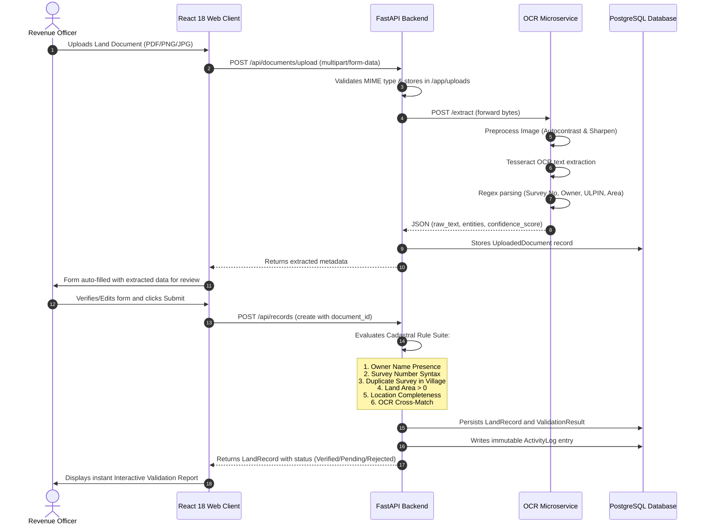
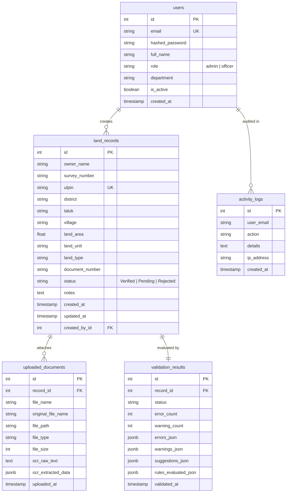

# System Architecture & Technical Specifications
## Intelligent Land Record Digitization and Validation System

This document outlines the architecture, data flows, database entity relationships, and infrastructure topology of the **Intelligent Land Record Digitization and Validation System (BHU-VAIDYA)**.

---

## 1. High-Level Architectural Diagram

The system follows a decoupled, microservices-oriented architecture designed for scalability, zero-trust container isolation, and cloud portability:

---

## 2. Ingestion & Intelligent Validation Workflow

When an officer uploads a land deed, mutation extract, or Patta certificate:

---

## 3. Database Entity Relationship Diagram (ERD)

---

## 4. Multi-Tier Security Framework

1. **Authentication:**
   - Stateless JWT tokens (`HS256`) signed with a configurable server secret.
   - SHA-256 password salting for stored officer passwords.
2. **Access Control:**
   - Role-Based Access Control (`admin` vs `officer`).
   - Administrative override controls for approvals/rejections and user onboarding.
3. **Database Security:**
   - Database resides in an internal Docker network inaccessible to the public internet.
   - Parameterized queries via SQLAlchemy ORM preventing SQL injection attacks.
4. **Input Sanitization & Validation:**
   - Pydantic v2 schemas validating payload structure, types, string lengths, and numeric bounds.
   - File extension and size throttling (max 15MB) to mitigate denial-of-service.
